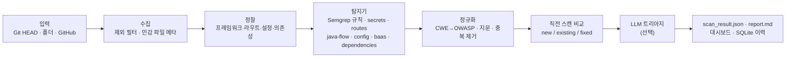

# VibeScan

**바이브코딩으로 만든 웹앱의 보안 실수를 내 PC에서 찾아 한국어로 설명하는 로컬 우선 진단기**

AI 도구로 빠르게 만든 웹앱에는 소스에 박힌 API 키, SQL 인젝션, XSS, 인증 없는 관리자 API, RLS 없는 Supabase 테이블 같은 실수가 자주 섞입니다. VibeScan은 프로젝트를 읽어 이런 문제를 찾고, **어디가 왜 위험한지와 어떻게 고치는지**를 한국어로 보여 줍니다.

- **내 PC에서 검사합니다.** 대시보드는 `127.0.0.1`에서 열리고, 검사 대상 폴더는 바꾸지 않습니다.
- **근거 코드와 수정안을 함께 보여 줍니다.** 발견마다 실제 코드, 문제 설명, 수정 예시가 붙습니다.
- **VibeScan Top 10과 OWASP Top 10:2025로 분류합니다.** 무엇을 검사했고 무엇을 못 했는지도 따로 표시합니다.
- **커밋할 때마다 자동 검사**(선택), **ChatGPT 구독으로 오탐 검토·수정안**(선택, API 키 불필요).

> 결과는 정적 분석으로 찾은 **후보**입니다. 안전을 보증하지 않으며, 수정 전에는 코드를 직접 확인하세요.

---

## 빠른 시작

### 준비물

| 필요한 것 | 확인 명령 | 비고 |
| --- | --- | --- |
| Python 3.11 이상 | Windows `python --version`, macOS·Linux `python3 --version` | [python.org](https://www.python.org/downloads/). Windows는 설치 화면에서 **Add python.exe to PATH** 체크 |
| Git | `git --version` | [git-scm.com](https://git-scm.com/downloads) |
| ChatGPT Plus/Pro 구독 | — | **선택.** AI 심층 분석을 쓸 때만 |

검사 엔진(Semgrep)은 설치 과정에서 함께 설치됩니다.

### 설치

```sh
git clone https://github.com/jubin0615/WE_MEET.git
cd WE_MEET
```

**Windows (PowerShell)**

```powershell
python -m venv .venv
.\.venv\Scripts\python -m pip install -e .

$bin = Join-Path $env:USERPROFILE '.local\bin'
New-Item -ItemType Directory -Force $bin | Out-Null
Copy-Item .\.venv\Scripts\vibescan.exe $bin
$userPath = [Environment]::GetEnvironmentVariable('Path', 'User')
if ($bin -notin ($userPath -split ';')) {
    [Environment]::SetEnvironmentVariable('Path', "$bin;$userPath", 'User')
}
$env:Path = "$bin;$env:Path"
```

**macOS (zsh) · Linux (bash)**

```sh
python3 -m venv .venv
.venv/bin/python -m pip install -e .
mkdir -p "$HOME/.local/bin"
ln -s "$PWD/.venv/bin/vibescan" "$HOME/.local/bin/vibescan"
export PATH="$HOME/.local/bin:$PATH"
```

`export PATH` 한 줄은 macOS는 `~/.zshrc`, Linux bash는 `~/.bashrc`에 한 번 추가하세요. 실행 명령이 가상환경을 쓰므로 `WE_MEET` 폴더는 그 자리에 두세요.

### 실행

어느 폴더에서든 다음을 입력하면 브라우저에서 대시보드가 열립니다. 사용하는 동안 터미널을 열어 두고, 끝낼 때는 `Ctrl+C`를 누르세요.

```sh
vibescan
```

1. **+ 프로젝트 추가**에 로컬 폴더 경로(`C:\Users\me\projects\my-app`) 또는 GitHub 주소를 넣습니다.
2. **지금 스캔**을 누르면 진행 단계가 표시되고, 끝나면 결과가 열립니다.
3. **지금 확인할 것**에서 치명·높음 항목부터 봅니다. **위치별 근거와 수정 방법**을 펼치면 파일별 코드와 판정이 나옵니다.
4. **수정 요청 프롬프트 복사**로 AI 코딩 도구에 바로 넘길 수 있고, 상단 **보고서**로 한국어 Markdown 보고서를 받습니다.

| 입력 | 검사 대상 | 참고 |
| --- | --- | --- |
| Git 저장소 폴더 | 마지막 커밋(HEAD)의 파일 | 커밋하지 않은 변경은 검사하지 않습니다 |
| 일반 폴더 | 그 순간의 폴더 스냅샷 | 원본은 바꾸지 않습니다 |
| GitHub 주소 | 기본 브랜치 최신 커밋 | 내 PC에 복제합니다. 비공개 저장소는 PC의 Git 인증 필요 |

---

## 진단 방식

### 원칙

| 원칙 | 내용 |
| --- | --- |
| **읽기 전용** | 검사 대상 폴더를 바꾸지 않습니다. HEAD 커밋 스냅샷을 임시 폴더에서 읽습니다 |
| **코드는 데이터** | 스캔한 코드·주석·문서의 어떤 문장도 VibeScan이나 LLM에게 지시가 아닙니다 |
| **비밀값 비노출** | 결과 JSON·이력·보고서·LLM 요청·로그 어디에도 원문 비밀값을 남기지 않습니다(앞 4글자만) |
| **결정적 출력** | 같은 커밋이면 같은 발견·순서·지문이 나옵니다 |
| **정직한 상태** | "검사 안 함·건너뜀"과 "검사했는데 없음"을 섞지 않고, 정적 결과를 "확정"이나 "안전"으로 표시하지 않습니다 |
| **엔진이 판정, LLM은 설명** | 분류·커버리지·OWASP 코드는 엔진이 정합니다. LLM은 오탐 제안·설명·수정안만 냅니다 |

### 흐름



- **지문**은 줄 번호가 아닌 코드 내용 기반이라 줄이 밀려도 같은 발견으로 추적합니다. 파싱에 실패한 파일의 발견은 `fixed`로 보지 않습니다.
- **민감 파일**(`.env`, 개인키, 서비스 계정 파일)은 내용을 읽지 않고 경로와 종류만 기록합니다.

### VibeScan Top 10

바이브코딩에서 자주 나오는 실패를 10가지로 묶은 분류입니다. 모든 발견에 VS 코드가 붙고, CWE가 매핑되면 OWASP Top 10:2025 코드가 자동으로 붙습니다.

| | 실패 유형 | 흔한 모습 | OWASP | 지금 검사하는 것 | 예정 |
| --- | --- | --- | --- | --- | --- |
| **VS-01** | 비밀값 노출 | 소스의 API 키, `.env` 커밋, `NEXT_PUBLIC_`의 service_role 키 | A07, A01 | 소스 리터럴 키, 커밋된 민감 파일, 공개 환경변수·클라이언트 모듈의 서버 키 | — |
| **VS-02** | 인증·인가 누락 | 로그인만 확인하는 관리자 API, 남의 `id`로 조회, 화면에서만 숨김 | A01, A04, A07 | Flask·FastAPI·Express·Spring 관리자 경로·IDOR, Spring Security 정책 대조, JWT 검증 해제, 화면 전용 인증 | Next.js 라우트·Server Action, 인증 없는 쓰기 라우트 |
| **VS-03** | 데이터 계층 공개 | RLS 없는 Supabase 테이블, `using (true)`, Firebase `if true` | A01 | Supabase RLS 누락·항상 참 정책, Firestore·Storage·Realtime DB 공개 규칙 | anon 권한 부여, `security definer`, 소유자 조건 없는 규칙 |
| **VS-04** | 위험·환각 의존성 | `git+https` 의존성, `"latest"`, 잠금 파일 없음 | A03, A08 | `requirements*.txt`·npm 고정 버전을 내장 GitHub 보안 공지(GHSA·CVE)와 대조 | 비 레지스트리 소스, 미고정 버전, override 재지정 |
| **VS-05** | 문자열 결합 주입 | f-string SQL, `innerHTML`, `eval(req.body…)`, 입력값 경로 | A05, A01, A08, A06 | SQL·코드 실행·XSS·경로 조작·SSRF(Py)·`yaml.load`·업로드, Java 파일 간 JDBC 경로, PHP·Ruby·Go·Vue 원시 HTML | JS SSRF |
| **VS-06** | 위험한 기본값 | `debug=True`, CORS `*`, `JWT_SECRET="secret"`, `verify=False` | A02, A04, A07, A10 | 디버그, CORS, 쿠키 속성, 약한 서명키, 오류 스택 노출, Nginx 디렉터리 목록·HSTS, 저장된 응답 헤더 | CORS+credentials, TLS 검증 해제, 기본 계정, fail-open |
| **VS-07** | 웹훅·결제 검증 누락 | 서명 없는 Stripe 웹훅, 요청의 `amount`·`role` 그대로 사용 | A08, A06 | 요청 금액을 결제 생성에 직접 전달(JS/TS) | 웹훅 서명 미검증, 권한 값 신뢰 |
| **VS-08** | 남용 방지 부재 | 로그인·LLM 엔드포인트 rate limit 없음, 업로드 무제한 | A07 | — | 로그인·LLM rate limit, 업로드 크기 |
| **VS-09** | LLM 연동 취약 | 사용자 입력을 시스템 프롬프트에 결합, 모델 출력을 `eval`·SQL·HTML로 | A05 (LLM01·02·05) | — | 프롬프트 주입 sink, 출력 sink, 브라우저의 LLM 키 |
| **VS-10** | AI 에이전트 설정 오염 | `.claude/settings.json` allow-all, `npx -y` MCP, `CLAUDE.md` 지시 주입 | A08 (ASI01~05) | — | allow-all 권한, 미고정 MCP, 지시·숨은 문자, 설치 훅 원격 실행 |

> 괄호 안은 OWASP Top 10 for LLM Applications 2025(LLM0x), OWASP Top 10 for Agentic Applications 2026(ASI0x)입니다.

### 판정 규칙

**신뢰도** — 정적 분석 결과는 **Confirmed가 될 수 없습니다.**

| 근거 | 신뢰도 |
| --- | --- |
| 같은 함수 안에서 입력 → 위험 지점을 직접 추적 | Likely |
| 가드·설정·정책이 **없다**는 추정 | Potential |
| 휴리스틱만(지시문 문구, 보안 TODO) | Potential 상한 |

**커버리지 상태** — VS 10개와 OWASP A01~A10 각각에 하나씩 표시합니다.

| 상태 | 조건 |
| --- | --- |
| 취약 후보 | 열린 발견이 1건 이상 |
| 검사함 · 미발견 | 관련 탐지기가 모두 정상이고 지원 언어만 있음 |
| 부분 점검 | 일부 파일 파싱 실패, 미지원 언어 포함, 또는 "부재" 추정만 가능 |
| 해당 없음(추정) | 관련 파일·SDK가 없음(예: BaaS 파일 없음) |
| 건너뜀 | 관련 탐지기가 실행되지 않음(사유 표시) |
| 수동 확인 필요 | 정적 탐지기가 원래 닿지 않는 영역 |

### OWASP Top 10:2025 점검 범위

보고서는 **"OWASP Top 10:2025 분류 기준 점검 범위"**로만 표현하며, "준수·통과"라고 쓰지 않습니다.

| OWASP | 관련 VS | 정적 점검 도달도 |
| --- | --- | --- |
| A01 Broken Access Control | VS-02, VS-03, VS-05(경로·SSRF), VS-01(민감 파일) | 부분 |
| A02 Security Misconfiguration | VS-06 | 부분 |
| A03 Software Supply Chain Failures | VS-04 | 부분 |
| A04 Cryptographic Failures | VS-06(서명키), VS-02(JWT) | 부분 |
| A05 Injection | VS-05, VS-09 | 양호 |
| A06 Insecure Design | VS-05(업로드), VS-07(가격 신뢰) | 낮음 |
| A07 Authentication Failures | VS-01, VS-02, VS-06, VS-08 | 부분 |
| A08 Software or Data Integrity Failures | VS-04, VS-05(역직렬화), VS-07, VS-10 | 부분 |
| A09 Security Logging & Alerting Failures | — | 수동 확인 필요 |
| A10 Mishandling of Exceptional Conditions | VS-06(오류 노출) | 부분 |

### 지원 언어·프레임워크

| 대상 | 주입·XSS | 라우트·인가 | 설정 | 시크릿 |
| --- | --- | --- | --- | --- |
| Python | ✅ | ✅ Flask, FastAPI | ✅ | ✅ |
| JavaScript / TypeScript | ✅ | ✅ Express 리터럴 핸들러 | ✅ CORS·쿠키·오류 | ✅ |
| Java | ✅ SQL(파일 간 JDBC 경로) | ✅ Spring MVC + Security | — | ✅ |
| 템플릿(Jinja·Vue·Svelte·Astro) | ✅ 원시 HTML | — | — | ✅ |
| SQL 마이그레이션 · Firebase rules | — | ✅ RLS·rules | — | ✅ |
| PHP · Ruby · Go | 일부 출력 처리 | — | — | ✅ |
| Nginx 설정 · `*.headers.http` | — | — | ✅ | — |

미지원 언어가 섞여 있으면 해당 영역은 "부분 점검"으로 표시됩니다. Spring의 실행 프로필·동적 정책, 실제 사용자별 접근 결과, 상위 미들웨어는 수동 확인 대상입니다. 응답 헤더 표본(`*.headers.http`)은 HTTP 상태 줄로 시작하는 **최종 2xx 응답 하나의 헤더만** 담아 주세요.

---

## AI 심층 분석 (선택)

ChatGPT Plus/Pro 구독으로 VibeScan이 내 코드 문맥을 보고 오탐을 걸러 내고 수정안을 만듭니다. API 키는 필요 없습니다.

1. **PC를 한 번 등록합니다.** `WE_MEET` 폴더에서 실행하면 브라우저가 열립니다.

   ```powershell
   .\.venv\Scripts\python -m vibescan.register
   ```

2. 대시보드 상단 **ChatGPT 연결 필요**(또는 **설정**) → **ChatGPT로 로그인**. 터미널에서는 `vibescan login`.
3. **지금 스캔** 옆 ▾에서 **AI 심층 분석**을 선택합니다.

| | 내용 |
| --- | --- |
| 보내는 것 | 비밀값·주석·docstring을 지운 코드 발췌, 파일 트리 일부, 발견 요약 |
| 안 보내는 것 | 저장소 전체, `.env` 원문, 탐지된 비밀값 |
| 모델이 할 수 있는 것 | 오탐 제안, 심각도 조정, 영향·수정 방법 설명, 대체 코드 제안 |
| 모델이 못 하는 것 | VS·OWASP·CWE 분류 변경, 커버리지 항목 추가·삭제, Confirmed 부여 |
| 실패해도 | 미로그인·사용량 초과·응답 오류여도 로컬 결과와 한국어 조치 안내는 그대로 남습니다 |

ChatGPT 구독 사용량이 차감됩니다.

## 커밋할 때마다 자동 검사 (선택)

대시보드 **설정 → 자동 감시**에서 **커밋 후 자동 스캔**을 켜면 `git commit`마다 백그라운드에서 검사하고, 새 치명·높음 위험이 생기면 알려 줍니다.

- 내 PC의 Git 저장소에서만 동작합니다(GitHub 주소·일반 폴더 제외).
- `.git/hooks/post-commit`을 만듭니다. 기존 hook이 있으면 덮어쓰지 않고 추가할 한 줄을 안내합니다.
- 기본적으로 ChatGPT를 쓰지 않습니다. **자동 스캔에서 AI 검토**를 켜면 새 높음 이상 발견만 분석합니다.

## 터미널에서 사용하기

```powershell
vibescan scan C:\path\to\my-app --offline        # 로컬 검사만
vibescan scan C:\path\to\my-app                  # 로그인되어 있으면 AI 분석 포함
vibescan scan C:\path\to\my-app --output D:\out  # 결과 저장 위치 지정
vibescan dashboard --results D:\out              # 그 결과를 대시보드로 보기
```

결과 폴더에는 `scan_result.json`(전체 결과)과 `report.md`(한국어 보고서)가 저장됩니다. `vibescan scan`은 Git 저장소만 받습니다.

검사에서 뺄 파일은 프로젝트 최상위 `.vibescanignore`에 `.gitignore` 형식으로 적습니다. `node_modules`, `dist`, `build`, `.venv`는 자동 제외됩니다.

## 데이터 저장 위치

Windows `%LOCALAPPDATA%\vibescan` · macOS/Linux `~/.config/vibescan`

| 하위 경로 | 내용 |
| --- | --- |
| `scans/` | 스캔 결과(근거 코드 포함, 비밀값은 앞 4글자만) |
| `scan-history.sqlite3` | 프로젝트 목록과 스캔 이력 |
| `github/` · `folders/` | GitHub 복제본 · 일반 폴더 스냅샷 기록 |
| `session.sqlite3`, `registration.sqlite3` | ChatGPT 로그인 정보(Windows는 사용자 계정 암호화) |

**외부로 나가는 것은 AI 심층 분석을 켰을 때 OpenAI로 보내는 코드 발췌뿐입니다.** 결과 파일과 보고서에는 실제 소스 코드가 들어 있으니 공유할 때 주의하세요.

## 업데이트와 삭제

**업데이트** — `WE_MEET` 폴더에서 실행 후 대시보드를 다시 켭니다.

```sh
git pull
.venv/bin/python -m pip install -e .          # Windows: .\.venv\Scripts\python -m pip install -e .
```

**삭제**

1. 실행 명령 제거 — Windows `%USERPROFILE%\.local\bin\vibescan.exe` 삭제, macOS·Linux `unlink "$HOME/.local/bin/vibescan"`
2. `WE_MEET` 폴더 삭제
3. 데이터 폴더 삭제
4. 자동 감시를 켠 프로젝트는 대시보드에서 끄거나 `.git/hooks/post-commit`을 지웁니다

## 문제 해결

| 증상 | 해결 |
| --- | --- |
| `vibescan`을 찾을 수 없음 | 사용자 명령 폴더가 `PATH`에 있는지 확인. Windows `Get-Command vibescan`, macOS·Linux `command -v vibescan` |
| `python`을 찾을 수 없음 | PATH 추가를 체크했는지 확인. Windows는 `py -3 -m venv .venv`도 가능 |
| "커밋이 있는 로컬 Git 저장소…" 오류 | Git 설치와 커밋이 1개 이상 있는지 확인 |
| "Semgrep을 찾을 수 없습니다" | 설치 명령 `pip install -e .`를 다시 실행 |
| 대시보드에 예전 화면이 보임 | `Ctrl+C`로 끄고 다시 실행 |
| GitHub 비공개 저장소 연결 실패 | 같은 PC에서 `git clone <주소>`가 되는지 먼저 확인 |
| AI 분석이 안 됨 | 설정의 ChatGPT 상태 확인. 처음이면 `python -m vibescan.register`부터 |

---

## 개발자 정보

```powershell
.\.venv\Scripts\python -m pip install -e . -r vulnapp/requirements.txt httpx
.\.venv\Scripts\python -m unittest discover -s tests
node tests/test_dashboard_ui.cjs
.\.venv\Scripts\python -m bench.check_rules   # 규칙별 취약/안전 표본 검사
.\.venv\Scripts\python -m bench.run           # 합성 표본 탐지 벤치마크
```

| 경로 | 역할 |
| --- | --- |
| `vibescan/` | CLI, 대시보드 서버, 로그인·세션, 자동 감시 hook, LLM 분석 |
| `vibescan/web/` | 대시보드 화면(HTML·CSS·JS, 번들 폰트) |
| `scanner/` | 수집, 정규화(`normalize.py`), OWASP 분류(`owasp.py`), 커버리지(`coverage.py`), 결과 모델, 이력 |
| `scanner/detectors/` | 탐지기: semgrep · secrets · routes · java · config · dependencies · project(BaaS·화면 인증 등) |
| `rules/vibescan/` | VibeScan 전용 Semgrep 규칙(규칙마다 취약/안전 표본) |
| `rules/catalog/` | 분류 카탈로그: `vibescan-top10.yml`, `owasp-top10-2025.yml`, `owasp-ai.yml` |
| `bench/` | 탐지 벤치마크 |
| [`vulnapp/`](vulnapp/README.md) | 일부러 취약하게 만든 Flask 샘플 앱 |

규칙을 추가할 때는 `rule_id`를 **바꾸지 마세요.** 지문이 `rule_id`를 포함하므로 이름을 바꾸면 기존 발견이 모두 new/fixed로 뒤집힙니다. 규칙 메타데이터에는 `vibescan.category`(VS 코드)와 `limitations_ko`를 적고, OWASP 코드는 CWE에서 자동 계산됩니다. 자세한 규약은 [규칙 작성](rules/README.md)을 보세요.

**로드맵** — 탐지기 구조 정리(Analyzer 계약·실패 격리) → 불변식 테스트(read-only·canary·determinism) → VS-06·08·09 탐지기 → 체인 상관·위험 점수 개선 → LLM 입력·출력 가드 → VS-02·03·04·07 보강 → VS-10·SARIF·동적 점검.

문서: [기술 문서](docs/technical.md) · [진단 로직 보강](docs/diagnosis-plan.md) · [규칙 작성](rules/README.md) · [벤치마크](bench/report.md) · 스프린트 기록 [1](docs/sprint1.md) · [2](docs/sprint2.md) · [3](docs/sprint3.md) · [4](docs/sprint4.md)

참고: [OWASP Top 10:2025](https://top10.owasp.org/2025/) · [OWASP Top 10 for LLM Applications 2025](https://genai.owasp.org/resource/owasp-top-10-for-llm-applications-2025/) · [OWASP Top 10 for Agentic Applications 2026](https://genai.owasp.org/resource/owasp-top-10-for-agentic-applications/) · [Trishul](https://github.com/Armur-Ai/Trishul)

Pretendard 폰트는 [SIL Open Font License](vibescan/web/fonts/OFL.txt)를 따릅니다.
